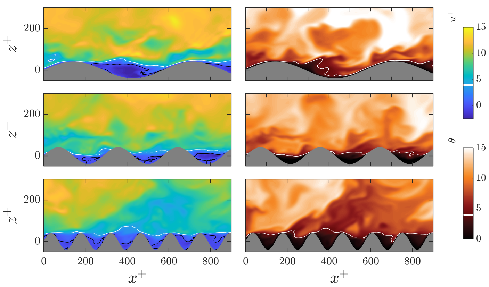

[Download the full thesis](http://hdl.handle.net/11343/267999).

A major area of interest in engineering is the skin-friction drag and convective heat transfer of surfaces in turbulent flow, such as turbine blades, marine vehicles, and airplanes. While these surfaces may appear smooth, they almost always have some form of roughness, for example, pitting on the surface of a turbine blade, barnacles on the hull of a marine vehicle, or rivets on the wings of an airplane. For a given roughness and flow speed, the Moody diagram can be used to find the frictional drag or pressure drop. A similar diagram can be constructed to find heat transfer. Although widely used, the biggest limitation of the Moody diagram is that the Nikuradse equivalent sand grain roughness has to be known for the rough surface in question. Another limitation of the Moody diagram is in predicting skin friction for transitionally rough surfaces, owing to the unrepresentative Colebrook fit. Also, while the effects of varying key roughness topographical parameters on momentum transfer have been studied extensively, relatively little is known on heat transfer. Over the years, researchers have used computational and experimental methods to investigate the flows over a number of roughness types. This thesis expands on the computational works on sinusoidal roughness by systematically investigating the effect of varying roughness solidity on both momentum and heat transfer in turbulent air flow, and the underlying flow physics that give rise to the observed behaviour. Rough-wall flows transfer more momentum and heat when compared to smooth-wall flows, and it is found that an increase in solidity for a matched equivalent sand-grain roughness height causes a greater increase in heat transfer than the increase in momentum transfer due to increased wetted area and increased recirculation region that facilitates mixing.

{fig-alt="Contour plots of velocity and temperature over rough walls"}
